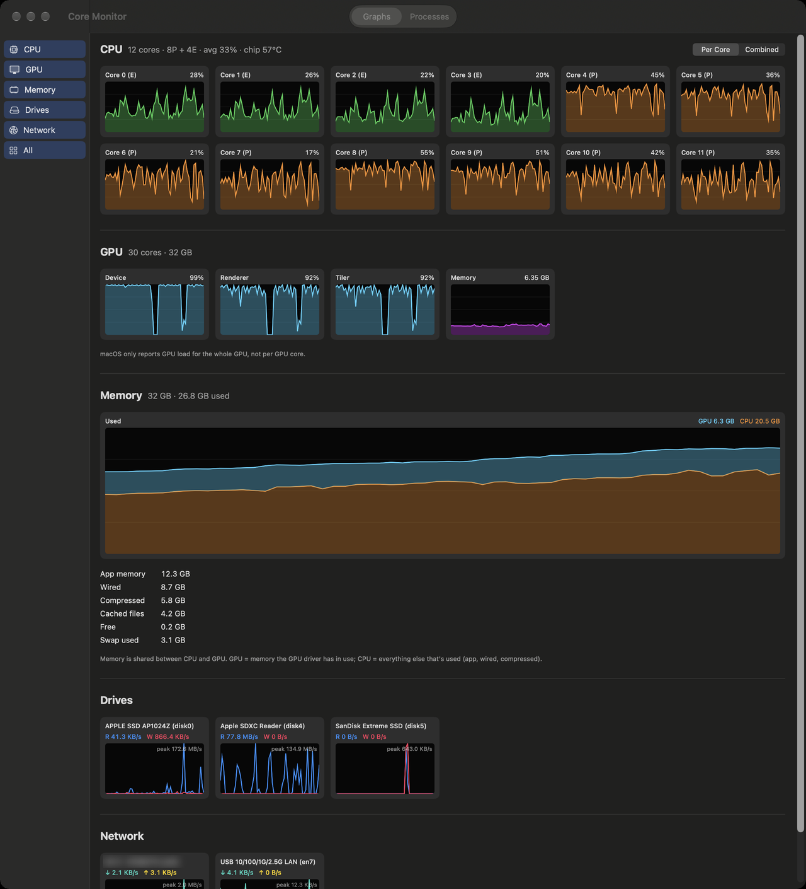
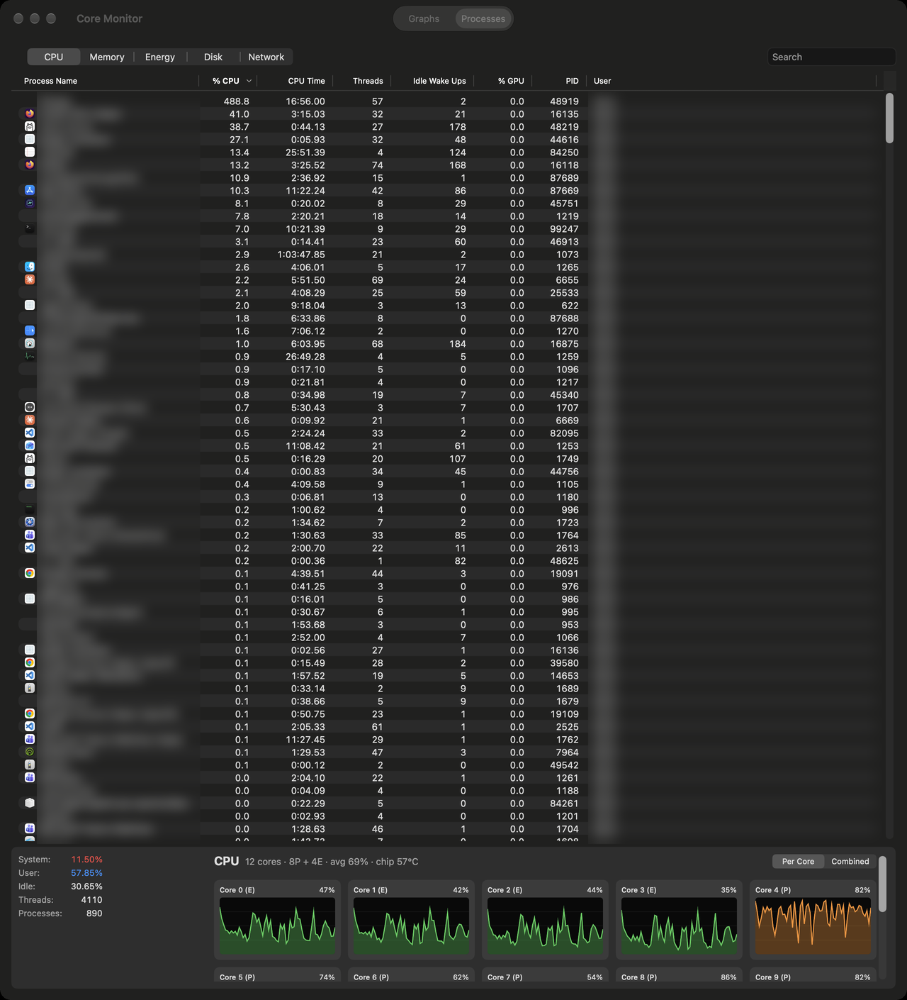

# Core Monitor

A lightweight native macOS system monitor for Apple Silicon, written in SwiftUI + AppKit.

- **Graphs**: per-core or combined CPU (with chip temperature), GPU, memory (CPU vs GPU, stacked), drives and network interfaces (with friendly names / Wi-Fi SSID). Multi-select (⌘/⇧-click) and drag to reorder sections.
- **Processes**: Activity Monitor-style CPU / Memory / Energy / Disk / Network views with app icons, per-network sent/received columns, and live summary graphs.

## Screenshots

**Graphs** (all sections selected)



**Processes** (CPU tab)



## Build

```sh
./build.sh   # compiles with swiftc, installs to /Applications/Core Monitor.app and launches it
```

Requires the Xcode command line tools. Wi-Fi network names need Location access (macOS requirement).
The icon is generated by `icon/make_icon.swift`.
